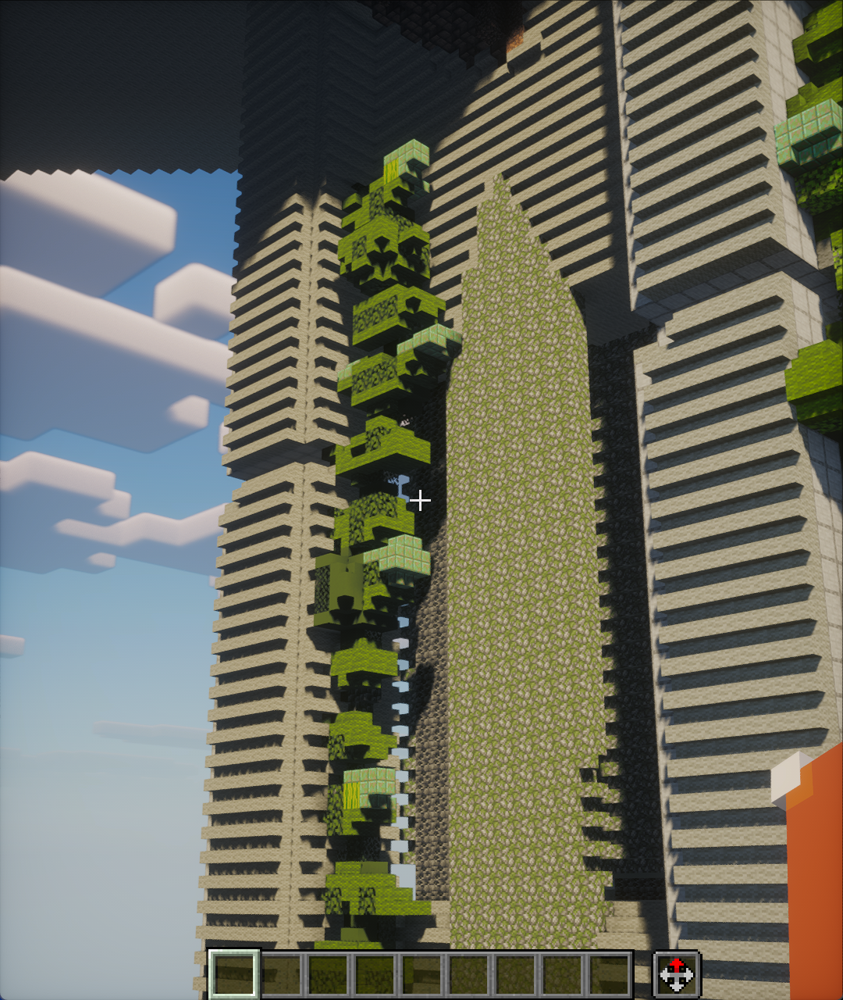
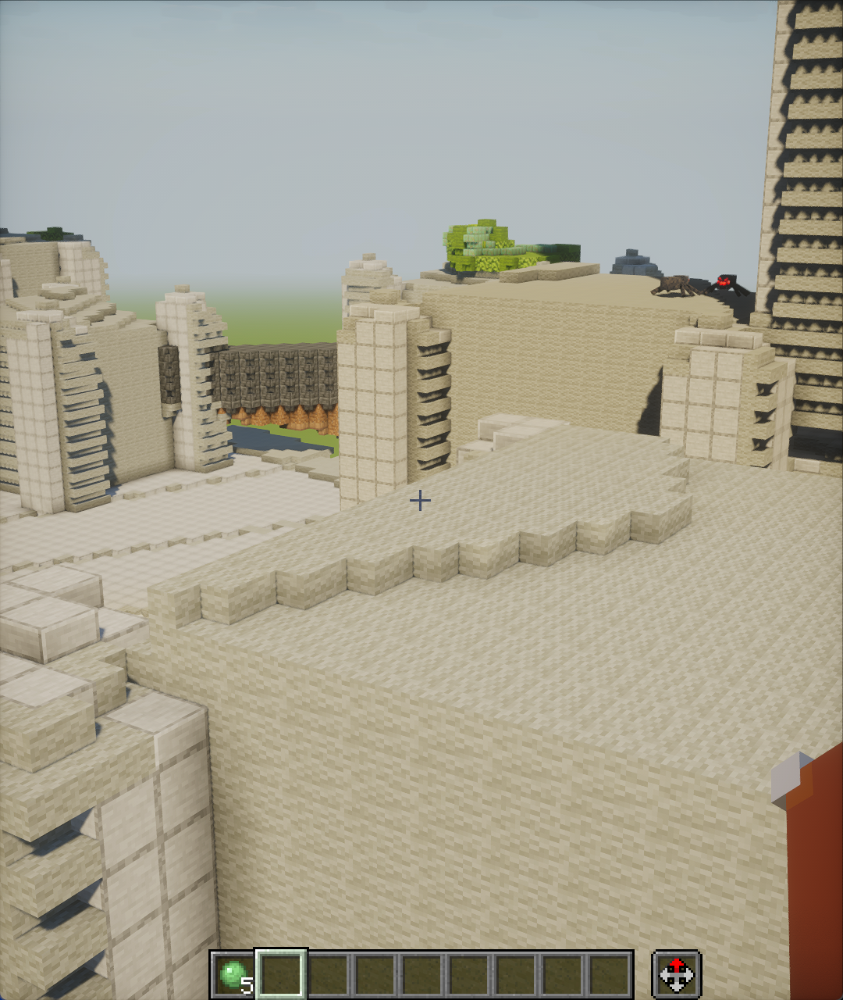
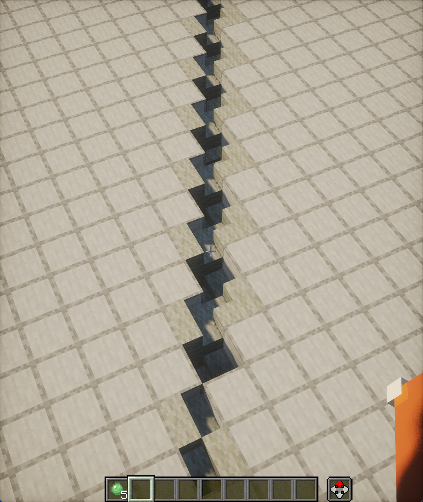

# GLB → SCHEM

在浏览器本地把静态建筑 GLB 转为 Minecraft Java 26.3 的 Sponge Schematic v2。模型无需上传，支持完整方块、上下半砖、楼梯和四向展示架。

## 实际效果

完整方块、半砖和楼梯共同还原柱体缝隙、镂空结构、平台台阶、斜向裂缝和植被起伏等复杂表面。以下为导入 Minecraft 后的游戏内截图。

<table>
  <tr>
    <td width="33.33%"></td>
    <td width="33.33%"></td>
    <td width="33.33%"></td>
  </tr>
</table>

## 使用

1. 从 Blender 导出 GLB 2.0：选择需要的建筑部件，嵌入资源，关闭 Draco 几何压缩。
2. 将文件拖入小方块组成的边框即可自动转换。边框上的原有方块保持位置，以连续非线性的大小、亮度和光晕过渡形成贪吃蛇循环；默认速率为原来的 1.4 倍，工作期间的加速进程为原来的两倍，到约 92% 进度后平滑减速并恢复闲置速度。加载框淡出后，可见方块从上方独立掉落，整体由低处逐步搭起。
3. 工具栏可修改最长水平边（默认 256），其余尺寸等比计算，底部归零；材质按钮可分别选择每种材质的完整方块、半砖、楼梯和展示架，支持中文名或方块 ID 搜索。
4. 工具栏可切换原模与方块结果；点击材质或切片按钮时，同一个顶部容器伸展开，内容在容器内显示。普通缩放速度提高到 3 倍，按住 Shift 恢复原有的精细速度。切片以四分之一格高度检查，按展示架的真实轮廓绘制。
5. 下载 `.schem`，在 Axiom 的 **File → Import Schematic** 中导入。

三维方块预览和材质面板使用内置的 Pixel Perfection Legacy 方块贴图，原模型保留 GLB 自带材质；切片采用代表色以便检查轮廓。以 GLB 的 Y 轴为上方，保持场景方向，粘贴原点为输出区域最小角。

## 本地开发与构建

需要 Node.js 22.18+（项目固定为 24.12.0）。

```sh
npm ci
npm run dev
```

```sh
npm run build
npm run preview
```

`npm run build` 自动执行核心测试、TypeScript 检查及生产构建，生成 `dist/`。`npm run typecheck` 和 `npm test` 可单独运行。

## Cloudflare Pages

**直接上传**：将交付的 `glb2schem-pages.zip` 上传到 Pages 的 Direct Upload 项目。压缩包根目录即为 `index.html`，无需再次构建。

**连接 Git 仓库**：将本项目设为根目录；框架选择 None，构建命令 `npm run build`，输出目录 `dist`，Node 版本使用 24.12.0。

没有服务端、Pages Functions、数据库、模型上传或第三方 CDN。`public/_headers` 随构建发布。部署前还应完成桌面视觉检查及目标 Axiom 中的实际导入核对。

## 几何处理与边界

- 恢复因法线、UV 和材质分片拆开的逻辑拓扑；检查封闭性，将封闭连通部件作为独立实体。
- 在空间分区索引上进行竖直扫描。每个部件分别求内部区间，再合并区间，避免相交实体发生 XOR 抵消。
- 每格以 36 条带面积权重的竖直射线积分八个半格子区，以及四向展示架的真实覆盖量。采样分区与半格、展示架边界对齐，不分配全世界的细网格；按体积误差选择空气、半砖、完整方块、楼梯或展示架。恰好 50% 时用对应子区中心采样消除歧义。封闭部件分别求区间后取并集，相交实体不会抵消。
- 楼梯包含四种朝向、正放与倒置，以及直线、内拐角、外拐角，共 40 种显式状态。拟合采用 Minecraft 的实际半格几何；三维预览、掉落动画、切片和导出使用同一形状。
- 展示架按原版模型的背板（厚 3/16 格）、上下凸沿（各高 1/4 格，最大深度 5/16 格）拟合，支持北、东、南、西四向。预览裁去相接内部面并合并共面矩形；动画的三部分共用一个方块落点。导出为空架、未充能、未连锁、未含水状态，不写入存放物品。
- 圆台辐条和裂缝按原几何采样，不进行平滑、填缝或全局膨胀；楼梯为斜线、圆弧和破损边缘提供更多贴合形状。更细的采样无法突破 Minecraft 方块本身的形状限制。
- 几何先确定，再按覆盖材质赋予方块。替换材质映射时保持几何不变。同格上下材质冲突时选总覆盖量较大的材质。
- 放置坐标精度为 1 格；半砖和楼梯内部可表达半格边界，展示架提供特定的更薄竖向形状，不能单独放置任意厚度的薄片。更细的缝和薄片仍可能丢失；模型必须有实际厚度。
- 嵌套且互不连接的封闭壳按多个实体取并集；密闭空腔应在 Blender 中建成具有连接拓扑的实体。透明贴图、动画、骨骼、Draco、Meshopt 和 KTX2 不在首版输入范围内。
- 最多 3200 万个输出方块位置。三维预览超过 125 万个可见三角面时保留完整转换数据，改用切片或导入游戏检查；导出不受预览限制影响。
- 预览在后台线程合并相邻表面，取消时终止线程。大模型的读取和 GLB 场景解析发生在主线程，读取阶段不显示取消按钮。
- 掉落动画使用独立方块及真实的竖直位移，完整方块、半砖和楼梯保留各自的尺寸和落点。楼梯由同一个方块锚点控制，组成部分同时运动。动画结束后释放实例，切回合并表面；封闭内部的完整方块、半砖、楼梯和展示架不参与动画，导出数据保持完整。动画从加载框淡出后的首个可见帧开始计时，慢帧和后台等待不会直接跳过掉落过程。超过 100 万个动画长方体实例或启用减少动态效果时直接显示模型。

## 材质库

当前目录包含 379 种完整方块材质、101 种半砖、97 种楼梯和 13 种展示架，共 590 个原版方块 ID。收录建筑、彩色和天然材料，排除容器、工作站、红石机关、生成器等功能方块；按用户要求，空展示架作为明确例外加入。栅栏、墙、玻璃板、花草、地毯等其他形状不参与拟合。

目录从本地原版 26.3 游戏文件提取，包含创造栏分类、真实模型、中文名和按贴图 alpha / 模型表面面积估算的代表色。铜的氧化与涂蜡系列完整展开；羊毛和混凝土各包含 16 色完整方块、半砖与楼梯。全部候选状态与对应版本的方块状态报告核对，避免根据名字臆造不存在的楼梯或半砖。

有同材质变体时优先配套；例如矿石、玻璃、树叶没有原生半砖或楼梯时，自动配合法的近色形状。四种形状可以分别手动修改，三维预览、面板缩略图与导出使用实际选中的方块；切片使用对应代表色。更换完整方块会更新未手动指定的搭配，保留已手动指定的半砖、楼梯和展示架；搜索也会保留当前选择。展示架只有游戏实际提供的木质版本，没有虚构的石质或彩色展示架。

树叶写出 `persistent=true`，避免自然掉叶。自动匹配不选择玻璃、冰及会失活的活珊瑚等易改变外观的选项，手动列表仍可选；铜色完全相同时优先涂蜡版本。模型仍需满足静态、封闭的 GLB 输入要求。

目录保存于 `src/data/block-catalog.json`，运行和构建无需本地 Minecraft。维护者可用 Python + Pillow 重新生成（仅此离线工具需要它们，不是网页生产依赖）：

```sh
python scripts/generate-catalog.py "路径/26.3.jar"
```

脚本只读取游戏文件，不启动游戏、不修改安装目录，也不把原版贴图或游戏 JAR 放进发布包。`scripts/data/catalog-audit.json` 记录分类来源和排除原因；版本固定为 26.3 / DataVersion 5023。

### 预览贴图与署名

网页内置 [Pixel Perfection Legacy 26.3-97.1](https://modrinth.com/resourcepack/pixel-perfection-legacy) 的必要方块贴图，原作者为 Hugh “XSSheep” Rutland，由 Nova_Wostra 与贡献者续作，贴图按 [CC BY-SA 4.0](https://creativecommons.org/licenses/by-sa/4.0/) 分发。署名、来源及改动说明随静态文件保存在 `public/textures/`；材质面板也提供作者页面入口。未打包 Minecraft 原版贴图。

590 个候选方块共用一张约 138 KB 的本地图集，按面方向选择贴图，合并大面仍按每格重复纹理；掉落实例与静态表面使用同一贴图。图集取动画首帧并烘焙植物色调，保留像素采样和镂空；预览不复现资源包的连接纹理、PBR、动画或 Minecraft 光影。贴图加载失败时恢复代表色，不影响转换与导出。

维护者可从获许可的资源包重新生成图集；本地游戏 JAR 仅提供方块状态和模型 JSON：

```sh
python scripts/build-textures.py "Pixel Perfection 26.3-97.1.zip" "路径/26.3.jar"
```

## 验证真实模型

```sh
node --experimental-strip-types scripts/verify-model.ts "模型.glb" "结果.schem"
```

脚本按 256 格转换，写出 `.schem` 和检查报告，并用独立 NBT 读取器逐格核对空气、完整方块、上下半砖及楼梯的朝向、上下位置与拐角。报告明确记录是否已在 Axiom 内验证；格式检查通过不等于已在游戏中验收。

展示架版建筑样本：256×256×150，完整方块 1,120,073、下半砖 34,137、上半砖 35,594、楼梯 54,548、展示架 72,479、空气 8,513,569。此前完整方块与半砖版已由用户在 Axiom 中确认可正常导入；新增形状版单独导出并记录验证状态。

## 字体

界面使用用户提供的钉钉进步体，英文展示字使用 Minecrafter Alt，均本地加载。中文字体按界面文字、方块名称和分类裁切为约 69 KB 的 WOFF2；未收录的自定义材质名称字符由系统字体补充。字体元数据中的署名保留于 `public/fonts/NOTICES.txt`。

维护者更新界面文案或材质库后，可用 Python + fonttools / Brotli 重新裁切；这些仅是离线工具，不是网页依赖：

```sh
python scripts/subset-fonts.py "DingTalk-JinBuTi.woff2" "Minecrafter.Alt.ttf"
```

## 格式与版本依据

- [Sponge Schematic v2 规范](https://github.com/SpongePowered/Schematic-Specification/blob/master/versions/schematic-2.md)：大端 NBT、gzip、Palette、VarInt BlockData，索引 `x + z * width + y * width * length`。
- [Minecraft 26.3 提取的版本元数据](https://raw.githubusercontent.com/misode/mcmeta/26.3-summary/version.json)：`DataVersion = 5023`。
- [Minecraft 26.3 提取的方块状态](https://raw.githubusercontent.com/misode/mcmeta/26.3-summary/blocks/data.json)：候选半砖采用 `type=bottom/top,waterlogged=false`，包含 26.3 的混凝土半砖。
- [Minecraft 26.3 官方更新说明](https://www.minecraft.net/en-us/article/minecraft-java-edition-26-3)：全部颜色的羊毛和混凝土新增楼梯、半砖。
- [Minecraft 原版楼梯模型](https://raw.githubusercontent.com/misode/mcmeta/assets/assets/minecraft/models/block/stairs.json)及[朝向与拐角映射](https://raw.githubusercontent.com/misode/mcmeta/assets/assets/minecraft/blockstates/oak_stairs.json)：楼梯预览与导出共用实际的几何掩码。
- [Axiom 官方导入说明](https://axiomdocs.moulberry.com/editor/mainmenubar/file.html)。

唯一生产依赖为 Three.js。Vite、TypeScript 和类型声明仅用于开发与构建；第三方许可随静态产物提供。
